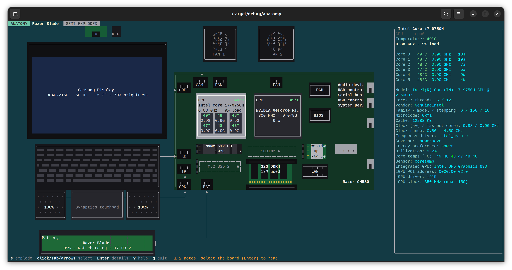

[](https://github.com/snshn/insider/actions?query=workflow%3AGNU%2FLinux)
[](https://github.com/snshn/insider/actions?query=workflow%3AmacOS)
[](https://github.com/snshn/insider/actions?query=workflow%3AWindows)

# insider



A realtime TUI hardware inspector that draws your mainboard. Ratatui, Linux, macOS, Windows, 0BSD.

Run it and you get a 2D picture of the machine. The default **semi-exploded**
view shows the mainboard with what has to be plugged in for it to work (CPU,
RAM, M.2 drives, Wi-Fi card) in place, and every peripheral — screen, camera,
microphone, keyboard, touchpad, speakers, battery, fans, USB devices — beside it
with an arrow to the connector or port it's cabled to. Temperatures and live
values sit on each part.

Press `e` for the **exploded** view: RAM, drives and cards also leave their
slots, with their data printed underneath. Soldered parts (laptop CPU/GPU, PCH,
BIOS and any chips the layout has no specific place for) always stay on the
board.

Click any part, or move with Tab/arrows and press Enter, to see everything known
about it: CAS latency and timings for RAM, PCIe link for GPUs/NVMe, battery
voltage/cycles/health, USB speed and drivers, and so on.

## Download

Every [release](https://github.com/snshn/insider/releases) has ready-made
executables: `insider-linux-{x86_64,aarch64,armhf}`, `Insider-{x86_64,aarch64}.AppImage`,
`insider-macos-{aarch64,x86_64}` and `insider-windows-x86_64.exe`.
The macOS ones are not signed: after downloading, run
`chmod +x insider-macos-* && xattr -d com.apple.quarantine insider-macos-*`.

## Build & run

    cargo build --release
    ./target/release/insider

No extra crates and no platform SDKs are needed: on every OS insider reads
what the system already offers (files, built-in tools) and parses it.

| | extras with elevated rights | reads from |
| --- | --- | --- |
| Linux | `sudo insider`: RAM SPD timings, CPU package power | sysfs/procfs; `lspci` (pciutils), `lsusb` (usbutils), `udevadm` (systemd), `dmidecode`, `nvidia-smi` when present |
| macOS | `sudo insider`: CPU/GPU temperatures and fans (Intel), per-core clocks and load, CPU/GPU/package power, thermal pressure | `system_profiler`, `sysctl`, `ioreg`, `vm_stat`, `netstat`, `ifconfig`, `hidutil`, `networksetup`, `osascript`; `powermetrics` as root |
| Windows | Administrator terminal: ACPI thermal zones, disk temperature/wear, Secure Boot state | Windows PowerShell 5.1 (CIM/WMI, PnP, registry), `netsh`; `nvidia-smi` when present |

On Windows run it in Windows Terminal (`.\target\release\insider.exe`). On
macOS any terminal works; one with 24-bit colour (iTerm2, WezTerm, Ghostty,
kitty, or Terminal on macOS 26+) shows the board colours as intended.

insider detects 24-bit colour from `COLORTERM`, `TERM` and `TERM_PROGRAM`, and
falls back to the 256-colour palette otherwise (e.g. Terminal.app before macOS
26, which garbles 24-bit sequences into stray coloured blocks). Override with
`--color truecolor|256` or `INSIDER_COLOR=truecolor|256`.

### Build in Docker

No Rust on the host needed, only Docker (or Podman) and make. The container
cross-compiles with [cargo-zigbuild](https://github.com/rust-cross/cargo-zigbuild),
so a Linux container produces a native binary for your machine, macOS included.

    make build              # throwaway build, binary in ./out/<target>/insider
    sudo make install       # copy it to /usr/local/bin (PREFIX=... to change)

    make dev                # incremental build, source mounted with -v
    make run                # same, then run it
    make test / lint / fmt / shell

`make build` extracts the binary with `docker build --output`, so no container
is left behind. `make dev` mounts the source and keeps build artifacts in the
`insider-target` volume, so rebuilds are fast; it runs as you, so `./out` stays
yours. `TARGET` defaults to this machine; set it to cross-build, e.g.
`make build TARGET=x86_64-pc-windows-gnu`, or run `make dist` for every
release target. `make clean` removes `./out` and the volume. On macOS the
binary is ad-hoc signed after building (Apple silicon won't run it otherwise).

| key | action |
| --- | --- |
| `e` `x` Space | assembled ⇄ exploded |
| click, Tab, arrows/hjkl | select |
| Enter `d` `i` | detail panel |
| PgUp/PgDn, wheel | scroll details |
| `?` | help |
| `q` | quit |

Options: `--board <file>` (try a layout file you're writing), `--list-boards`, `--exploded`, `--interval <ms>`, `--color <truecolor|256>`,
`--no-nvidia-smi`, and `--dump`, which prints everything detected plus the
slot assignment as plain text. That dump is the thing to share when a board
needs a proper layout.

### Notes

* **RAM timings** (Linux) come from the SPD EEPROM: `sudo modprobe ee1004` (DDR4) or
  `spd5118` (DDR5), then run with sudo. Without it you still get size, type,
  speed, part number and slot from SMBIOS (via udev, no root needed).
* **NVIDIA Optimus** (Linux): when the dGPU is runtime-suspended (D3) insider leaves it
  alone and shows "asleep". When it is awake it polls `nvidia-smi` every ~5 s;
  use `--no-nvidia-smi` if you'd rather never touch it.
* **macOS**: everything slow (`system_profiler`) is refreshed on a background
  thread every 30 s; Wi-Fi/Bluetooth details arrive a few seconds after start.
  Apple silicon has no command-line source for per-sensor temperatures, so
  insider shows thermal pressure (as root) instead. RAM on Apple silicon is
  one "unified memory" part, bound as `unified`.
* **Windows**: the inventory comes from one PowerShell run at start (and every
  30 s); live values from one PowerShell process kept running, so refreshes
  don't pay PowerShell's start-up time. Windows has no built-in interface for
  CPU core temperatures; the ACPI thermal zone is shown.
* `INSIDER_SYSROOT=/path` reads `/sys` and `/proc` from a captured tree, and
  `$INSIDER_SYSROOT/cmd/<tool>_<args>` (or `cmd/<tool>`) as that tool's
  recorded output. Handy for developing layouts for machines you don't have.
* `INSIDER_CAPTURE=/path insider --dump` records every tool's output into
  `/path/cmd/`. Copy that folder anywhere and replay it with
  `INSIDER_SYSROOT=/path INSIDER_PLATFORM=macos insider` (or `windows`,
  `linux`) — e.g. capture on a Mac, develop its layout on Linux.

## Board layouts

Layouts are TOML files. insider picks one itself: a layout whose `[[match]]`
fits the machine's DMI data wins; otherwise it falls back to a generic stand-in
chosen from what it found (SODIMM/CAMM memory, a battery or a laptop chassis
type mean a laptop board, otherwise ATX). Built-ins: `stock-laptop` and
`stock-atx`. Your own go in `~/.config/insider/boards/` (macOS also
`~/Library/Application Support/insider/boards/`, Windows
`%APPDATA%\insider\boards\`) or `./boards/`; a file with the same id (file
stem) as a built-in replaces it. `insider --help` lists the search path.

The DMI fields mean the same on every OS: on Windows they come from SMBIOS
via WMI, so one layout matches a PC under Linux and Windows alike. Macs report
`sys_vendor = "Apple Inc."`, `product_name` = the model name ("MacBook Pro")
and `board_name` = the model identifier ("MacBookPro16,1"), so a Mac layout
matches with `board_name = "MacBookPro16,1"`.

```toml
name = "Razer Blade 15 (Mid 2019)"
form = "laptop"            # "laptop" or "desktop"
width = 100                # design grid, in terminal cells; scaled to fit
height = 36
pcb = { x = 0, y = 0, w = 100, h = 24 }
color = "#101010"          # PCB colour

[[match]]                  # any [[match]] whose fields all match wins
sys_vendor = "Razer"       # case-insensitive substring of /sys/class/dmi/id/*
product_name = "Blade 15"

[[slot]]
id = "dimm0"
kind = "dimm"              # cpu gpu dimm ssd wifi ethernet chipset bios battery
                           # usb usb-internal fan display camera keyboard
                           # touchpad speaker microphone connector pci pcie
                           # rj45
x = 42
y = 12
w = 31
h = 3
label = "SODIMM A"
edge = "bottom"            # side with the gold contacts (dimm, ssd, wifi)
bind = ["ChannelA-DIMM0"]  # optional: only accept the part exposing this key
# link = "edp"             # a peripheral cabled to a connector slot: stays where
                           # it is drawn, with an arrow to that connector.
                           # On an rj45 jack: the LAN controller slot whose
                           # link and traffic its LEDs show
# catchall = true          # soldered area for parts no other slot took
# soldered = true          # stays on the board in exploded view
# multi = true             # takes all remaining parts of its kind
# accepts = ["gpu", "pci"] # override which part kinds fit
```

`bind` keys: DIMM locator / bank locator (SMBIOS), USB root port such as `1-2`,
PCI address such as `0000:01:00.0`, `nvme` / `sata` for drives, interface name
for network cards, `internal`/`eDP`/`HDMI-A` for displays. Without `bind`, parts fill slots of their kind in order.
USB ports are `bus-port` from the location ID on macOS and `hub-port` from the
device location on Windows, so they differ between OSes; PCI addresses,
DIMM locators and display types do not.
`insider --dump` shows each part's bind keys.

A cell is about twice as tall as it is wide, so draw things about 2× wider than
on a photo.

## License

0BSD
